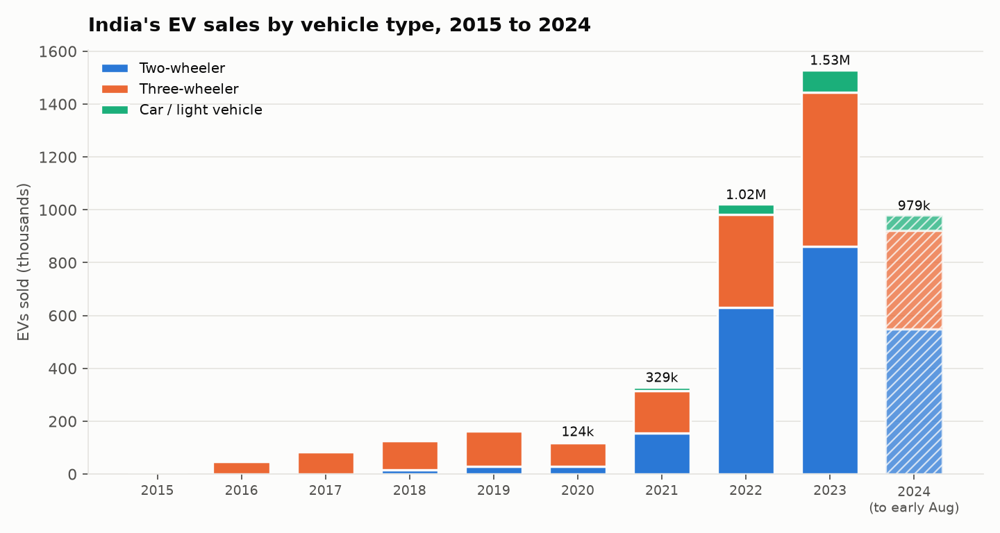
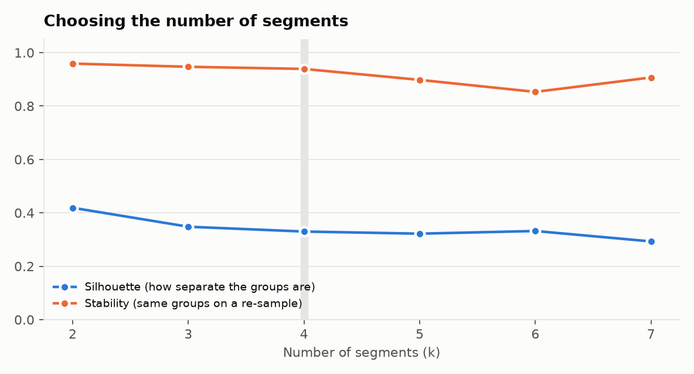
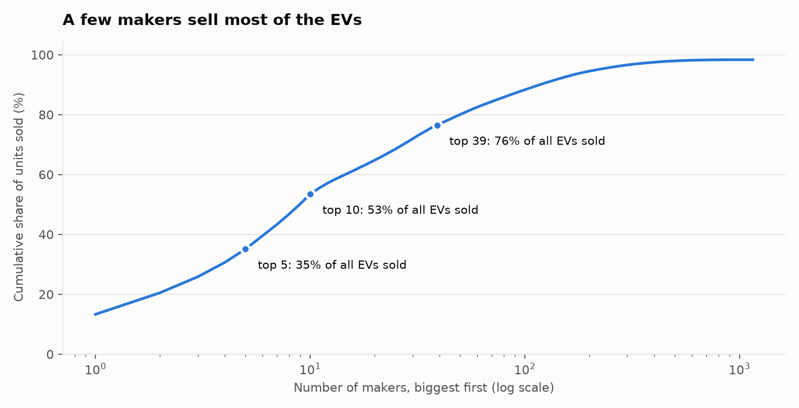
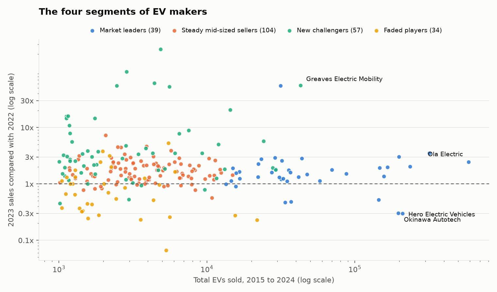
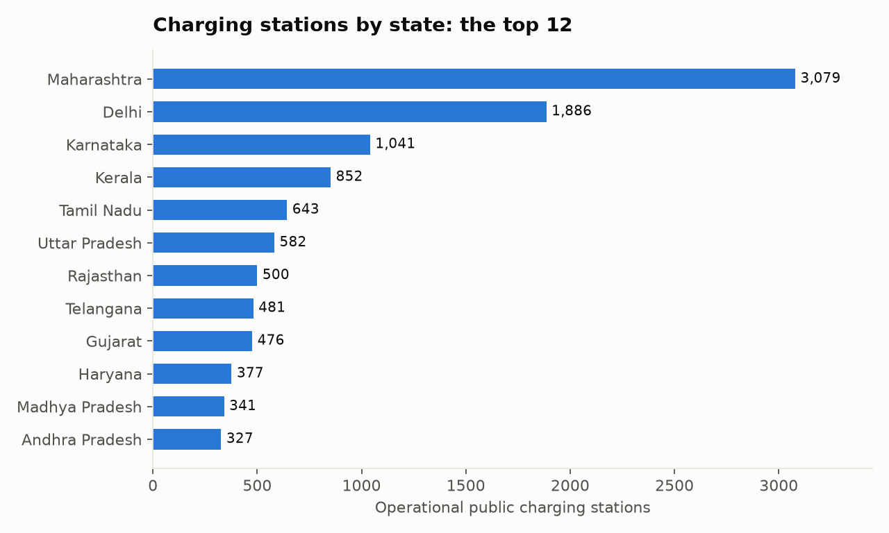
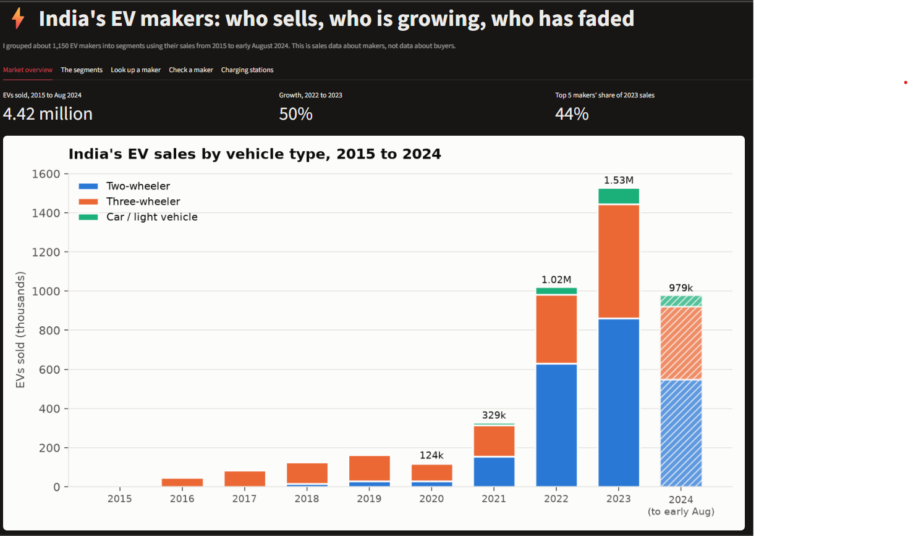

# EV Market Segmentation (India)

**Live app:** _add your Streamlit link here after you deploy_

I wanted to know who actually sells electric vehicles in India, who is growing, and who has faded. The data has about 1,150 EV makers and ten years of sales. I grouped the makers into four segments, then turned the result into a small web app.



## What the data is, and what it isn't

I started with the idea of segmenting buyers. Then I opened the files, and there are no buyers in them. It's sales and infrastructure data, so the honest project is **segmenting the makers**, not the customers. I'd rather say that up front than pretend otherwise.

The five Excel files:

| File | What's in it |
|---|---|
| EV sales by maker and category | Units sold each year, 2015 to 2024, for each maker and vehicle type (1,386 rows) |
| EV registrations by vehicle class | Monthly EV registrations, 2001 to August 2024 |
| All vehicle registrations by class | Total registered vehicles of every kind (petrol, diesel and EV) |
| Operational charging stations | Stations in each of 34 states and territories |
| EV makers by place | Where about 60 makers have their plants or head offices |

Source: the dataset was provided to me during my machine learning internship at Feynn Labs. I did the cleaning, the analysis and the app here myself.

**2024 is not a full year.** The data stops in early August 2024, and the last month is only a few days. So I never compare 2024 with other years. I use 2023 as the latest full year.

## What I did to the data

- **Merged duplicate names.** The same company shows up as "AMPERE VEHICLES PRIVATE LIMITED" and "AMPERE VEHICLES PVT LTD". Merging spelling variants took 1,196 names down to 1,156.
- **Merged some companies by hand.** Tata's EV business is listed under three names and Mahindra's under three. I combined each into one (`Tata Motors (EV)`, `Mahindra Group`), plus a few smaller ones. These are my judgement calls, so they sit in plain view in `src/clean.py` for anyone to question.
- **Removed two rows that aren't makers.** One is an "Others" bucket, one is called "Nic Test Account 1". Together they're 72,900 units, about 1.6% of the total. They stay in the market totals but out of the maker analysis.
- **Checked the files agree.** The yearly totals from the maker table and the monthly registrations table match within about 0.2% for 2023, so I trust both.

## How I segmented the makers

Almost every maker sells one type of vehicle (87%), so clustering on vehicle type just splits them into two-wheeler, three-wheeler and car makers. That's true, but it tells a business nothing new. I clustered on **how a maker is doing** instead, using five numbers for each:

1. How big it is (total units sold)
2. How much of its sales came in the last three years
3. Its 2023 sales compared with its best year
4. Growth from 2022 to 2023
5. The first year it sold anything

I only clustered the **234 makers that sold at least 1,000 EVs**. They account for 97% of all sales. The other 920 are tiny, many sold a few dozen units, and they'd make the clusters noisy. I report them as the "long tail" and don't force them into a segment.

I used K-Means with four segments. How I picked four, and how sure I am:

- Higher scores mean cleaner groups. Four segments score **0.33** on silhouette (a measure of how separate the groups are), which is modest. Two segments score higher (0.42), but two groups would be just "big" and "everyone else".
- I refit on random 80% samples 30 times and compared the groups each time. The agreement score averaged **0.94** (1.0 means identical groups), so the segments aren't an accident of the random start.
- So the honest summary is: the four segments are stable, but their edges are blurry. Makers near a boundary could go either way.



## What I found

**1. The market is growing fast and is almost all two- and three-wheelers.** Sales went from 1.02 million in 2022 to 1.53 million in 2023, up 49.8%. In 2023, two-wheelers were 56.3% of sales, three-wheelers 38.2% and cars only 5.5%. Looking at everything registered in India, about 17% of three-wheelers are electric, against 0.84% of two-wheelers and 0.28% of cars. (That last comparison is rough: the all-vehicle file has no date, so I can't be sure it covers the same period.)

**2. A small group sells most of the EVs.** The top 5 makers sold 44.3% of everything in 2023, and the top 10 are 53.5% of all sales since 2015. Ola Electric alone is 13%.



**3. Four kinds of maker.**

| Segment | Makers | Share of all EVs sold | What they look like |
|---|---|---|---|
| Market leaders | 39 | 76.1% | Big volumes, mostly still near their best year |
| Steady mid-sized sellers | 104 | 11.1% | Around since about 2017, mid-sized, holding steady |
| New challengers | 57 | 7.2% | Started around 2021, sales more than doubled in 2023 |
| Faded players | 34 | 2.7% | Sales in 2023 far below their best year |
| Long tail (under 1,000 units) | 920 | 3.0% | Tiny sellers, left out of the clustering |



**4. "Market leader" doesn't mean "safe".** Five of the 39 leaders fell sharply in 2023. Hero Electric went from 100,367 units in 2022 to 29,964 in 2023. Okinawa went from 103,620 to 31,617, and Ampere from 82,247 to 42,911. The data doesn't say why. My guess is the subsidy changes in 2023, but that's a guess I haven't checked. Meanwhile the leaders list also contains Ola, TVS and Ather, which kept growing. The clustering puts them together because it looks at size, so I added the "5 of 39" check on top.

**5. New challengers are real, but they started from small numbers.** Greaves Electric Mobility went from 410 units in 2022 to 24,045 in 2023. Okaya EV went from 8,913 to 15,816. Fast growth from a small base looks dramatic, so I only trust it when the 2023 number is large enough to matter.

**6. Charging stations are concentrated.** There are 12,146 operational stations. Maharashtra has 3,079 and Delhi 1,886, and the top five states hold 61.8% of all of them.



## The app

Five tabs: market overview, the segments, a lookup for any maker (with its sales by year and similar makers), a box where you type in a maker's numbers and see which segment it would fall into, and charging stations.



Run it yourself:

```bash
pip install -r requirements.txt
python src/clean.py       # tidy the five Excel files
python src/segment.py     # clustering, tables and charts
streamlit run app.py      # open the app
```

Deployment steps are in [DEPLOY.md](DEPLOY.md).

## Limits I'd say out loud

- **It's makers, not buyers.** I can say who sells EVs. I can't say who buys them or why.
- **Segments have blurry edges.** The silhouette score is modest (0.33). Treat a maker near a boundary as "could be either".
- **2024 is partial**, so growth is measured 2022 to 2023 only. A maker that grew a lot in 2024 won't show it.
- **My name merges are judgement.** If you disagree that, say, Tata's three entries are one company, change `ALIASES` in `src/clean.py` and rerun.
- **No profit, price or model data**, so "big" means units, not money.
- **The charging data has no sales by state**, so I can't tell whether stations are where the EVs are.
- **The "why" behind any rise or fall is outside this data.** I only describe what the numbers show.

## What I'd do next

- Add state-level or city-level sales and see if charger counts predict EV adoption.
- Add price and battery data so segments could be based on what a maker sells, not only how much.
- Rebuild once 2024 is complete, and check whether the fallen leaders recovered.
- Track segment changes year by year, to see how often a maker moves from "challenger" to "leader".

## Files

```
ev-market-segmentation/
├── app.py              the Streamlit app
├── src/
│   ├── clean.py        tidy the raw files
│   ├── lib.py          features, clustering, naming (shared with the app)
│   └── segment.py      analysis, tables, charts
├── data/raw/           the five original Excel files
├── data/clean/         tidied CSVs
├── outputs/            charts, tables and metrics.json (every number above)
├── DEPLOY.md
└── requirements.txt
```
